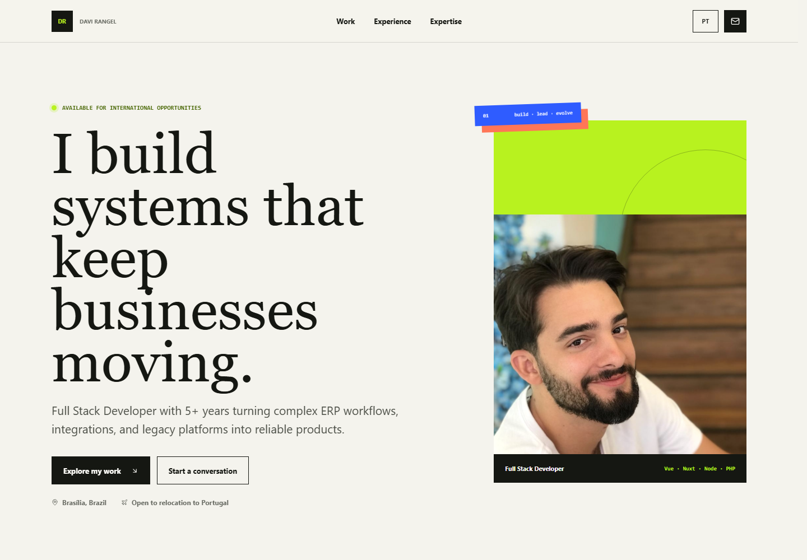
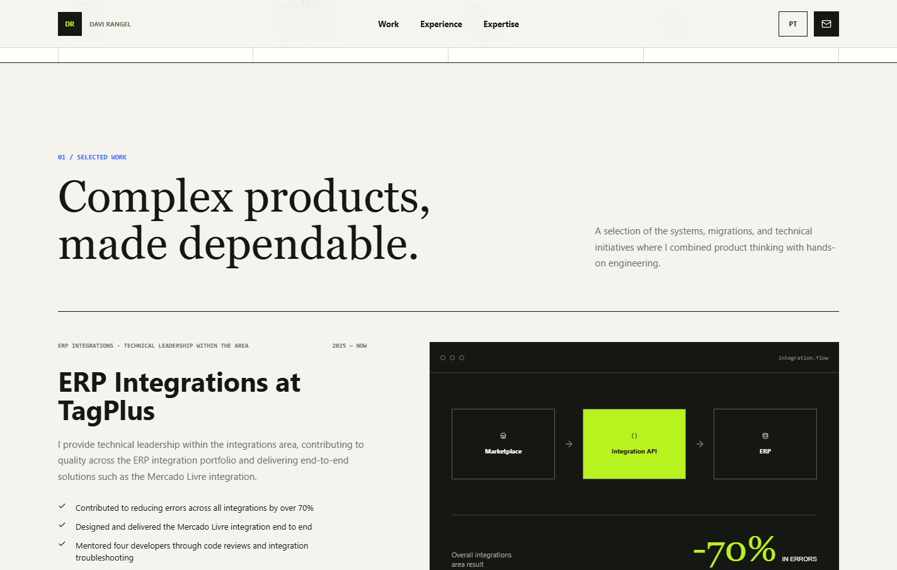
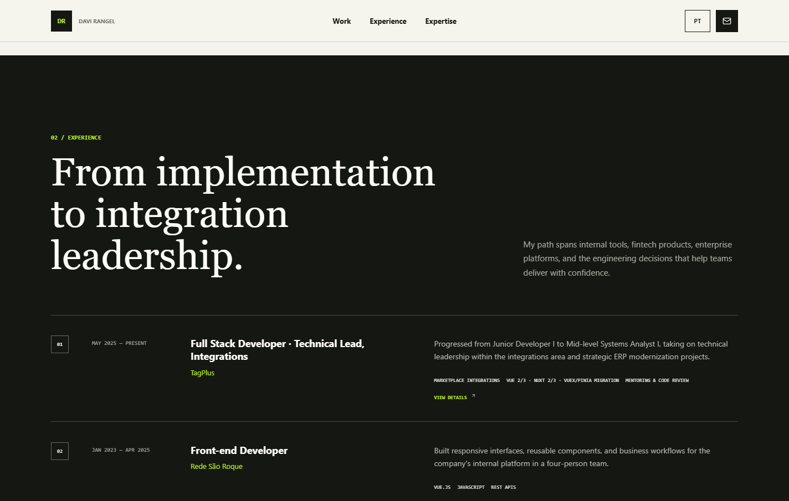

# Davi Rangel | Full Stack Developer Portfolio

Personal portfolio built to present my professional experience, selected case studies, technical expertise, education, and contact channels in a clear, interactive format.

The interface is available in English and Brazilian Portuguese and was designed as a responsive, accessible experience for recruiters, engineering leaders, and potential collaborators.



## Highlights

- Professional and independent projects presented as interactive case studies
- Career history with role-by-role progression inside each company
- Project and experience details displayed in accessible modal dialogs
- Full-screen detail views on mobile devices
- English and Brazilian Portuguese content without locale prefixes in the URL
- Language preference persisted in a cookie
- Localized email and WhatsApp messages based on the selected language
- Downloadable resumes in English and Portuguese
- Responsive navigation for desktop and mobile
- Local Lucide icon bundle with no runtime dependency on an external icon service
- Localized metadata for search engines and social sharing
- Keyboard navigation, focus management, and reduced-motion support

## Interface

### Selected work

The project section combines professional initiatives with independent work. Each item can be opened to show its context, responsibilities, outcomes, technology stack, and external links when available.



### Professional experience

The experience section summarizes the professional timeline. Opening an entry reveals the progression of roles within that company, including dates, responsibilities, achievements, and technologies used.



## Technology Stack

| Area | Technology |
| --- | --- |
| Framework | Nuxt 4 |
| UI | Vue 3 |
| Language | TypeScript |
| Internationalization | `@nuxtjs/i18n` and Vue I18n |
| Icons | `@nuxt/icon` with local Lucide icons |
| Styling | Custom responsive CSS |
| Rendering | Nuxt server-side rendering |
| Validation | Nuxt type checking and production build |

## Project Structure

```text
Portfolio/
|-- docs/
|   `-- images/                 # README screenshots
|-- frontend/
|   |-- app/
|   |   |-- assets/css/
|   |   |   `-- main.css       # Design system and responsive styles
|   |   |-- pages/
|   |   |   `-- index.vue      # Main page, interactions, and modals
|   |   `-- app.vue
|   |-- i18n/locales/
|   |   |-- en.json            # English content
|   |   `-- pt.json            # Brazilian Portuguese content
|   |-- public/
|   |   |-- cv/                # Localized resumes
|   |   |-- images/            # Portfolio assets
|   |   `-- favicon.svg
|   |-- nuxt.config.ts
|   `-- package.json
`-- README.md
```

## Getting Started

### Requirements

- Node.js `^22.22.3`, `^24.15.0`, or `>=26.0.0`
- npm

### Installation

```bash
git clone https://github.com/drcs2000/Portfolio.git
cd Portfolio/frontend
npm install
```

### Development

```bash
npm run dev
```

The development server is available at `http://localhost:3000` by default.

## Available Scripts

| Command | Description |
| --- | --- |
| `npm run dev` | Starts the Nuxt development server |
| `npm run build` | Creates the production SSR build |
| `npm run preview` | Runs the production build locally |
| `npm run generate` | Generates a static version of the site |
| `npm run typecheck` | Validates Vue and TypeScript types |

## Internationalization

English is the default locale. Portuguese can be selected from the header without changing the current URL because the application uses Nuxt I18n's `no_prefix` strategy.

The selected locale is stored in the `portfolio_locale` cookie. Interface labels, project descriptions, experience timelines, SEO metadata, contact templates, and resume links all react to the active language.

Content can be updated in:

```text
frontend/i18n/locales/en.json
frontend/i18n/locales/pt.json
```

Both files follow the same structure. Keep their keys aligned when adding projects, positions, skills, or other sections.

## Interaction and Accessibility

- Project and experience entries are operable by mouse and keyboard
- Modal dialogs trap focus while open and restore focus to their trigger on close
- Dialogs can be closed with the close button, backdrop, or `Escape`
- Semantic labels describe navigation, controls, and interactive content
- Focus-visible states make keyboard navigation clear
- Animations respect `prefers-reduced-motion`
- Mobile dialogs occupy the full viewport for easier reading and dismissal

## Production

Create and test a production build with:

```bash
cd frontend
npm run build
npm run preview
```

For a Node deployment, the generated server entry point is:

```bash
node .output/server/index.mjs
```

## Contact

- [LinkedIn](https://www.linkedin.com/in/davirangelcamara)
- [GitHub](https://github.com/drcs2000)
- Email: `davirangelcamara@gmail.com`

---

Designed and developed by **Davi Rangel**.
